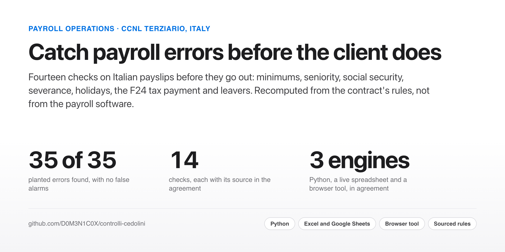
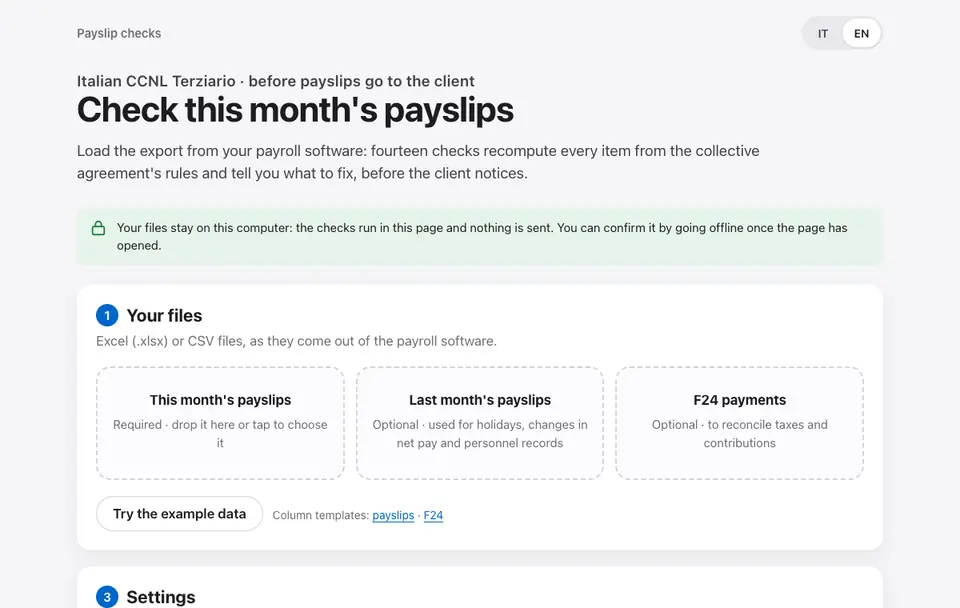

<picture>
  <source media="(prefers-color-scheme: dark)" srcset="site-assets/cover-dark.png">
  
</picture>

<p align="center">
  <a href="https://d0m3n1c0x.github.io/controlli-cedolini/strumento/?lang=en"><b>Try the browser tool</b></a> ·
  <a href="https://d0m3n1c0x.github.io/controlli-cedolini/">Read the September report</a> ·
  <a href="https://github.com/D0M3N1C0X/controlli-cedolini/raw/main/deliverables/foglio_controllo_cedolini.xlsx">Download the checking sheet</a>
</p>

<p align="center">
  <a href="https://github.com/D0M3N1C0X/controlli-cedolini/actions/workflows/ci.yml"></a>
  
  
  
</p>

## Why this matters

An Italian payroll provider sends hundreds of payslips a month to its clients, and every mistake the client finds
first costs money and trust: a minimum still at last year's rate, a seniority step not applied, social security on the
wrong base, a tax payment that does not match the payslips. These **fourteen checks run before the payslips go out**.
Each one **recomputes the item from the rules of the collective agreement** (CCNL Terziario, the contract for retail
and services), or compares it with last month and with the F24 tax payment, so it does not depend on how the payroll
software calculated it.

> **Synthetic data, real rules.** Three clients and 122 invented employees, with errors planted on purpose; minimums
> (rebuilt to the cent from the employers' association's note), seniority steps, holidays and notice periods of the
> CCNL Terziario, with every source in [docs/fonti.md](docs/fonti.md). Not legal advice. The report, the catalogue
> and the runbook are in Italian, the language of Italian payroll; the browser tool switches between Italian and
> English.

## What it finds, on September 2026

| | |
|---|---|
| **35 flags on 122 payslips and 3 F24 payments**, 24 high priority. Each with the expected value, the value found and what to do. | **6 employees below the minimum:** basic pay is stuck at the March 2025 rate. €175.44 a month in all, plus arrears since November 2025. |
| **One F24 with €212.40 less in withholding tax** than the client's payslips add up to. | **November 2026:** €3,765.80 a month of higher minimums for those who stay; absorbable personal supplements cover €1,385.82, leaving **€2,379.98 a month** to pay. |
| **Six leavers in September**, three with an error: the 14th month counted from January, untaken holiday paid at 1/30, a dismissal with half the notice the agreement requires. | |

## The fourteen checks

| Code | Check | How |
|---|---|---|
| C01 | Minimum basic pay | Base pay, other elements and cost-of-living allowance = the grade's minimum × part-time share |
| C02 | Seniority steps | Steps earned since the hiring date (ten three-year steps, from the following month) × the grade's amount |
| C03 | Social security (INPS) | Employee contribution = contribution base rounded to the euro × rate |
| C04 | Severance accrual (TFR) | Accrual = ordinary pay × 14 / 13.5 / 12 |
| C05 | Holiday balance | Balance = last month's balance + 26/12 − days taken |
| C06 | Payslip arithmetic | Gross = sum of the items; net = gross − deductions |
| C07 | Change in net pay | More than 20% against last month with no event recorded (hiring, overtime, part-time, leaving) |
| C08 | F24 reconciliation | Withholding tax (code 1001) and contributions paid = the sum of the client's payslips |
| C09 | Tax code | Check character |
| C10 | Personnel records | Grade, part-time, supplement or hiring date changed since last month with no event: the coherent error that starts with a change |
| C11 | 13th and 14th month accruals | Twelfths from January (13th) and July (14th) against the months of service: a month counts with at least 15 days |
| C12 | 13th and 14th month paid | Monthly pay × twelfths earned / 12: in December from the accruals, on leaving up to the last day |
| C13 | Untaken holiday | On leaving, monthly pay / 26 × days left |
| C14 | Notice period | Calendar days at least the agreement's minimum for grade, years of service and resignation or dismissal |

## See it run

Drop the payroll export into the page, Excel or CSV: columns are matched by name, Italian number and date formats
are read as they are, and every flag comes with what to do, ready to download in Excel or print for the client.
**The files never leave the computer.**

<p align="center"><a href="https://d0m3n1c0x.github.io/controlli-cedolini/strumento/?lang=en"></a></p>

## What you get

| Deliverable | For | What is in it |
|---|---|---|
| [Browser tool](https://d0m3n1c0x.github.io/controlli-cedolini/strumento/?lang=en) | the payroll team | The checks on the month's export, Excel or CSV, in the page; results to download in Excel or print; Italian and English. |
| [`foglio_controllo_cedolini.xlsx`](deliverables/foglio_controllo_cedolini.xlsx) | whoever runs payroll without code | Paste this month's and last month's payslips (up to 250 rows, formulas ready) and the F24: OK or ERRORE row by row, a summary per client, the November tranche, editable settings. Opens in Excel, LibreOffice and Google Sheets. |
| [Report](https://d0m3n1c0x.github.io/controlli-cedolini/) | the team lead | The flags with what to do, the F24, the November tranche and how far the checks can be trusted (in Italian). |
| [Catalogue of checks](docs/catalogo-controlli.md) · [runbook](docs/guida-operativa.md) | the payroll team | One card per check (rule, source, sheet formula, a real example, causes, limits) and the monthly procedure: who does what, triage, release criteria (in Italian). |
| [Sources](docs/fonti.md) · [decisions](docs/decisioni.md) · [data dictionary](docs/dizionario-dati.md) | reviewers | The source and status of every rule, every choice of method with the alternative it replaced, every column (in Italian). |

## How far you can trust it

- **On the planted errors:** 35 found out of 35, no false alarms, and no flag on the legitimate cases (hires in the
  month, declared overtime, a move to part-time, correct leavers). This shows the checks do what they claim, not that
  they would find real errors: I chose the errors.
- **On 1,100 random alterations** of a correct payslip, any item by any amount: above the one-cent tolerance, all are
  found.
- **Rules against statistics:** an anomaly detector that does not know the agreement finds 11 wrong payslips out of 34, with 7 false alarms; the rules find 34 of 34, with none.
  It only sees errors that move a ratio (contributions, severance, change in net pay), never minimums, steps, records or
  accruals.
- **The limit, narrowed by C10:** a *coherent* error passes every arithmetic check. A grade-4 employee entered at
  grade 5, with the payslip recomputed from scratch, adds up in every item and takes home €61.29 less a month. If the
  error starts with a change from last month, C10 finds it; it stays invisible only if it was wrong from the hiring
  date, where the client's documents are the check. A test keeps this limit true.
- **Three engines, one answer:** the sheet is checked against Python on 580 values and recalculated with LibreOffice
  in CI; the browser tool is checked against Python on 2,219 values, including half-cent alterations and Italian file
  formats. The sheet's reconciliation uses [excel-twin](https://github.com/D0M3N1C0X/excel-twin).

## The judgement calls

- **Recompute, do not compare only.** Last month's payslip hides an error that repeats every month; the rules do not.
- **One cent of tolerance** on every amount, because payroll software rounds differently at the cent.
- **Minimums rebuilt from the primary source**, the employers' association's note of 29 March 2024, after the
  secondary sources turned out to miss a €260.76 element for managers (Quadri) and to be off by a cent or two elsewhere.
- **Optional columns stay optional:** without the accrual or leaving columns, those checks do not apply and the
  others still run.
- **A change in net pay is a question, not an error:** C07 sends the team to the client for the event behind it.

The full list is in [docs/decisioni.md](docs/decisioni.md).

## Limits

- **Social security simplified:** one 9.19% rate for everyone; FIS, CIGS and the extra 1% are not modelled. In real
  use the rate comes from the client's INPS position.
- **One agreement, a month without absences:** sickness, leave, year-end adjustments and the pay in lieu of notice are
  not checked; for leavers the 13th and 14th month, untaken holiday and notice days are, the severance paid is not.
  The synthetic income tax is not computed with the tax rules: it only feeds the F24.
- **Sources:** seniority step amounts come from two concordant secondary sources and should be checked against the
  agreement's text before real use.

<details>
<summary><b>For engineers: how to run it, what is inside</b></summary>

```bash
python3 -m venv .venv && . .venv/bin/activate
pip install -r requirements.txt
python src/run_all.py            # about 30 seconds
pip install -r requirements-dev.txt
pytest                           # includes the sheet calculated in pure Python against pandas
ruff check .
node tests/js/check_controlli.mjs   # the browser tool against Python
```

```
├── data/
│   ├── ccnl_terziario.csv   minimi per tranche e scatti, con fonte
│   ├── cedolini.csv         agosto e settembre 2026, sintetici
│   ├── f24.csv              deleghe di settembre per cliente
│   └── errori_inseriti.csv  cosa è stato sbagliato apposta, per misurare i controlli
├── src/
│   ├── config.py            parametri e soglie
│   ├── regole.py            le regole del contratto, scritte una volta
│   ├── controlli.py         i quattordici controlli, la tranche di novembre, la valutazione
│   ├── robustezza.py        alterazioni casuali e l'errore coerente
│   ├── statistica.py        regole contro un rilevatore statistico
│   ├── build_foglio.py      il foglio di calcolo con le formule
│   ├── build_rapporto.py    il rapporto
│   ├── build_catalogo.py    il catalogo dei controlli, dalle regole e dal foglio
│   ├── genera.py            i dati sintetici
│   └── run_all.py           tutto in un comando
├── deliverables/            il foglio di calcolo
├── report/                  rapporto, pagina HTML, segnalazioni
├── docs/
│   ├── catalogo-controlli.md una scheda per controllo, generata dal codice
│   ├── guida-operativa.md   la procedura del mese per il team paghe
│   ├── architettura.md      come restano uguali le tre versioni
│   ├── roadmap.md           cosa viene dopo
│   ├── fonti.md             fonte e stato di ogni regola, correzioni
│   ├── decisioni.md         le scelte di metodo e le alternative scartate
│   └── dizionario-dati.md   ogni colonna dei dati
└── tests/
```

</details>

## About

Built by **Domenico Perroni**: HR advisory for the Italian market, people analytics and reward, based in Kraków.
[GitHub](https://github.com/D0M3N1C0X) · [LinkedIn](https://www.linkedin.com/in/domenico-perroni) · [Portfolio](https://d0m3n1c0x.github.io/)

**More from the same portfolio**

- [pay-transparency-readiness-kit](https://github.com/D0M3N1C0X/pay-transparency-readiness-kit) — the EU Pay Transparency Directive run end to end for a four-country employer, with a [browser tool](https://d0m3n1c0x.github.io/pay-transparency-readiness-kit/tool/) for a client's own payroll
- [workforce-cost-model](https://github.com/D0M3N1C0X/workforce-cost-model) — what people cost in Italy and Poland, with INPS, TFR and ZUS: budget variance and scenarios in Excel reconciled with pandas, and a [scenario simulator](https://d0m3n1c0x.github.io/workforce-cost-model/simulator/)
- [equal-value-pay-ranges](https://github.com/D0M3N1C0X/equal-value-pay-ranges) — pay ranges of equal value by grade and country, priced on Eurostat data
- [excel-twin](https://github.com/D0M3N1C0X/excel-twin) — the small library that proves this sheet's formulas match the Python

MIT licensed.
