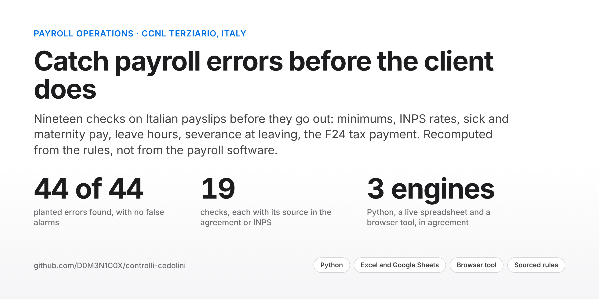
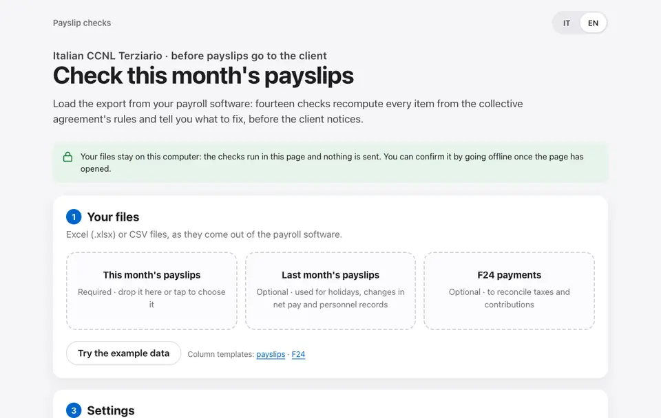

<picture>
  <source media="(prefers-color-scheme: dark)" srcset="site-assets/cover-dark.png">
  
</picture>

<p align="center">
  <a href="https://d0m3n1c0x.github.io/controlli-cedolini/strumento/?lang=en"><b>Try the browser tool</b></a> ·
  <a href="https://d0m3n1c0x.github.io/controlli-cedolini/">Read the September report</a> ·
  <a href="https://github.com/D0M3N1C0X/controlli-cedolini/raw/main/deliverables/foglio_controllo_cedolini.xlsx">Download the checking sheet</a>
</p>

<p align="center">
  <a href="https://github.com/D0M3N1C0X/controlli-cedolini/actions/workflows/ci.yml"></a>
  
  
  
</p>

## Why this matters

An Italian payroll provider sends hundreds of payslips a month to its clients, and every mistake the client finds
first costs money and trust: a minimum still at last year's rate, a seniority step not applied, social security on the
wrong base, income tax withheld with last year's table. These **twenty-one checks run before the payslips go out**.
Each one **recomputes the item from the rules of the collective agreement** (CCNL Terziario, the contract for retail
and services), INPS and the 2026 income tax law, or compares it with last month and with the F24 tax payment, so it does not depend on how the payroll
software calculated it.

> **Synthetic data, real rules.** Three clients and 124 invented employees, with errors planted on purpose; minimums
> (rebuilt to the cent from the employers' association's note), seniority steps, holidays, leave hours and notice
> periods of the CCNL Terziario; INPS rates by position, sick and maternity pay from INPS circulars; severance
> revaluation from ISTAT's indices, recomputed to the sixth decimal; income tax with the 2026 brackets, credits,
> tax-wedge measures and the adjustment at leaving, read in the official texts. Every source is in [docs/fonti.md](docs/fonti.md). Not legal advice. The report, the catalogue
> and the runbook are in Italian, the language of Italian payroll; the browser tool switches between Italian and
> English.

## What it finds, on September 2026

| | |
|---|---|
| **49 flags on 124 payslips and 3 F24 payments**, 35 high priority. Each with the expected value, the value found and what to do. | **6 employees below the minimum:** basic pay is stuck at the March 2025 rate. €175.44 a month in all, plus arrears since November 2025. |
| **Five contributions withheld at the wrong rate:** CIGS and the FIS share missing where the client averages more than 15 staff, CIGS taken where it averages fewer, and the extra 1% forgotten on pay above €4,685 a month. | **One F24 with €212.40 less in withholding tax** than the client's payslips add up to. |
| **Six leavers in September**, with errors in the 14th month, untaken holiday, notice and three severance payments: a coefficient from the wrong month, the 17% substitute tax not deducted, the 0.50% left in. | **Absences and leave:** sick pay based on 1/26 instead of × 14/12 / 30, waiting days paid on the fifth sickness of the year, maternity pay without the accruals in its base, leave hours accrued as if full-time and senior. |
| **Income tax, real rules:** one payslip still taxed at the 2025 table (35% instead of 33%), one without the €1,000 tax-wedge credit, one low earner without the tax-wedge payment; two leavers' year-end adjustments wrong, with a full year's credits or none at all. | **November 2026:** €3,892.67 a month of higher minimums for those who stay; absorbable personal supplements cover €1,443.69, leaving **€2,448.98 a month** to pay. |

## The twenty-one checks

| Code | Check | How |
|---|---|---|
| C01 | Minimum basic pay | Base pay, other elements and cost-of-living allowance = the grade's minimum × part-time share |
| C02 | Seniority steps | Steps earned since the hiring date (ten three-year steps, from the following month) × the grade's amount |
| C03 | Social security (INPS) | Contribution base rounded to the euro × the position's rate: 9.19% pensions, + 0.30% CIGS above 15 staff on average in the half-year, + a third of the FIS; + 1% above €4,685 a month |
| C04 | Severance accrual (TFR) | Accrual = ordinary pay × 14 / 13.5 / 12 |
| C05 | Holiday balance | Balance = last month's balance + 26/12 − days taken |
| C06 | Payslip arithmetic | Gross = sum of the items; net = gross − deductions |
| C07 | Change in net pay | More than 20% against last month with no event recorded (hiring, overtime, part-time, leaving) |
| C08 | F24 reconciliation | Withholding tax (code 1001) and contributions paid = the sum of the client's payslips |
| C09 | Tax code | Check character |
| C10 | Personnel records | Grade, part-time, supplement or hiring date changed since last month with no event: the coherent error that starts with a change |
| C11 | 13th and 14th month accruals | Twelfths from January (13th) and July (14th) against the months of service: a month counts with at least 15 days |
| C12 | 13th and 14th month paid | Monthly pay × twelfths earned / 12: in December from the accruals, on leaving up to the last day |
| C13 | Untaken holiday | On leaving, monthly pay / 26 × days left |
| C14 | Notice period | Calendar days at least the agreement's minimum for grade, years of service and resignation or dismissal |
| C15 | INPS sick pay | Last month's pay × 14/12 / 30, at 50% for days 4-20 of the sickness and 66.66% for days 21-180 |
| C16 | Waiting days | The first 3 days topped up in full for the year's first two sicknesses, 66% and 50% for the third and fourth, not from the fifth, unless exempt |
| C17 | INPS maternity pay | 80% of the same daily pay, for each day of leave in the month |
| C18 | Leave hours (ROL and former holidays) | Balance = last month's + (72 or 56 + 32 hours) / 12 × part-time − hours taken; staff hired after March 2011 earn the 72 at 50% after 2 years and in full after 4 |
| C19 | Severance pay at leaving (TFR) | Fund at 31 December + revaluation (1.5% a year + 75% of the ISTAT index rise; the month counts from the 15th) − 17% tax on it + the year's accruals − 0.50% |
| C20 | Income tax of the month (IRPEF) | 23% / 33% / 43% brackets scaled to the month, minus a twelfth of the employment credit and of the extra tax-wedge credit on the year's expected income; tax-wedge payment up to €20,000 and supplementary allowance up to €15,000 |
| C21 | Income tax adjustment at leaving | The year's tax on taxable pay since January, credits and allowance in proportion to the days worked, minus what was already withheld or paid |

## See it run

Drop the payroll export into the page, Excel or CSV: columns are matched by name, Italian number and date formats
are read as they are, and every flag comes with what to do, ready to download in Excel or print for the client.
**The files never leave the computer.**

<p align="center"><a href="https://d0m3n1c0x.github.io/controlli-cedolini/strumento/?lang=en"></a></p>

## What you get

| Deliverable | For | What is in it |
|---|---|---|
| [Browser tool](https://d0m3n1c0x.github.io/controlli-cedolini/strumento/?lang=en) | the payroll team | The checks on the month's export, Excel or CSV, in the page; results to download in Excel or print; Italian and English. |
| [`foglio_controllo_cedolini.xlsx`](deliverables/foglio_controllo_cedolini.xlsx) | whoever runs payroll without code | Paste this month's and last month's payslips (up to 250 rows, formulas ready) and the F24: OK or ERRORE row by row, a summary per client, the November tranche, editable settings. Opens in Excel, LibreOffice and Google Sheets. |
| [Report](https://d0m3n1c0x.github.io/controlli-cedolini/) | the team lead | The flags with what to do, the F24, the November tranche and how far the checks can be trusted (in Italian). |
| [Catalogue of checks](docs/catalogo-controlli.md) · [runbook](docs/guida-operativa.md) | the payroll team | One card per check (rule, source, sheet formula, a real example, causes, limits) and the monthly procedure: who does what, triage, release criteria (in Italian). |
| [Sources](docs/fonti.md) · [decisions](docs/decisioni.md) · [data dictionary](docs/dizionario-dati.md) | reviewers | The source and status of every rule, every choice of method with the alternative it replaced, every column (in Italian). |

## How far you can trust it

- **On the planted errors:** 49 found out of 49, no false alarms, and no flag on the legitimate cases (hires in the
  month, declared overtime, a move to part-time, correct leavers, a sickness on the fifth event with no waiting days,
  an exempt one with them, a maternity leave, a high earner with the extra 1%). This shows the checks do what they claim, not that
  they would find real errors: I chose the errors.
- **On 1,100 random alterations** of a correct payslip, any item by any amount: above the one-cent tolerance, all are
  found.
- **Rules against statistics:** an anomaly detector that does not know the agreement, comparing each payslip with the
  same client's, finds 17 wrong payslips out of 45, with 9 false alarms; the rules find 45 of 45, with none.
  It only sees errors that move a ratio (contributions, severance, change in net pay, leavers), never minimums, steps,
  records, accruals, income tax, absences or leave hours.
- **The limit, narrowed by C10:** a *coherent* error passes every arithmetic check. A grade-4 employee entered at
  grade 5, with the payslip recomputed from scratch, adds up in every item and takes home €77.98 less a month. If the
  error starts with a change from last month, C10 finds it; it stays invisible only if it was wrong from the hiring
  date, where the client's documents are the check. A test keeps this limit true.
- **Three engines, one answer:** the sheet is checked against Python on 983 values and recalculated with LibreOffice
  in CI; the browser tool is checked against Python on 2,898 values, including half-cent alterations of absences,
  severance and income tax, and Italian file formats. The sheet's reconciliation uses [excel-twin](https://github.com/D0M3N1C0X/excel-twin).

## The judgement calls

- **Recompute, do not compare only.** Last month's payslip hides an error that repeats every month; the rules do not.
- **One cent of tolerance** on every amount, because payroll software rounds differently at the cent.
- **Minimums rebuilt from the primary source**, the employers' association's note of 29 March 2024, after the
  secondary sources turned out to miss a €260.76 element for managers (Quadri) and to be off by a cent or two elsewhere.
- **Optional columns stay optional:** without the accrual or leaving columns, those checks do not apply and the
  others still run.
- **A change in net pay is a question, not an error:** C07 sends the team to the client for the event behind it.
- **INPS's share, not yet the employer's top-up:** the agreement tops sick and maternity pay up to a share of *net*
  pay. Income tax is now recomputed, but the sample payslips keep full pay in absence months; the top-up check comes
  with the next data revision. C15-C17 check what INPS owes and whether waiting days are paid when due.
- **The year's income is estimated from the month:** monthly pay × 14 decides credits and tax-wedge measures, and the
  credits count for a twelfth; software that estimates from the year to date withholds differently month by month,
  and the year-end adjustment evens it out.
- **The INPS position is the client's:** the half-year average decides CIGS and FIS, today's headcount the leave
  hours; one client sits under 15 on average and over 15 today, and is checked as such.

The full list is in [docs/decisioni.md](docs/decisioni.md).

## Limits

- **One agreement, part of the tax:** only the CCNL Terziario; the employer's top-up of sick and maternity pay, the
  December year-end adjustment, regional and municipal add-on taxes, family credits, the pay in lieu of notice and the
  separate taxation of severance are not checked. Income tax is checked in ordinary months and at leaving.
- **Social security:** the FIS reduction for small employers, bilateral funds other than the FIS and contribution
  reliefs are not modelled.
- **Sources:** the agreement's rules on steps, accruals, notice, sickness, maternity and leave come from the union's
  summary of the 2011 renewal; the employers' note on the 2024 renewal shows those articles did not change then, but
  the 2015 renewal was not reread. Check against the current text before real use.

<details>
<summary><b>For engineers: how to run it, what is inside</b></summary>

```bash
python3 -m venv .venv && . .venv/bin/activate
pip install -r requirements.txt
python src/run_all.py            # about 30 seconds
pip install -r requirements-dev.txt
pytest                           # includes the sheet calculated in pure Python against pandas
ruff check .
node tests/js/check_controlli.mjs   # the browser tool against Python
```

```
├── data/
│   ├── ccnl_terziario.csv   minimi per tranche e scatti, con fonte
│   ├── cedolini.csv         agosto e settembre 2026, sintetici
│   ├── f24.csv              deleghe di settembre per cliente
│   └── errori_inseriti.csv  cosa è stato sbagliato apposta, per misurare i controlli
├── src/
│   ├── config.py            parametri e soglie
│   ├── regole.py            le regole del contratto, scritte una volta
│   ├── controlli.py         i ventuno controlli, la tranche di novembre, la valutazione
│   ├── robustezza.py        alterazioni casuali e l'errore coerente
│   ├── statistica.py        regole contro un rilevatore statistico
│   ├── build_foglio.py      il foglio di calcolo con le formule
│   ├── build_rapporto.py    il rapporto
│   ├── build_catalogo.py    il catalogo dei controlli, dalle regole e dal foglio
│   ├── genera.py            i dati sintetici
│   └── run_all.py           tutto in un comando
├── deliverables/            il foglio di calcolo
├── report/                  rapporto, pagina HTML, segnalazioni
├── docs/
│   ├── catalogo-controlli.md una scheda per controllo, generata dal codice
│   ├── guida-operativa.md   la procedura del mese per il team paghe
│   ├── architettura.md      come restano uguali le tre versioni
│   ├── roadmap.md           cosa viene dopo
│   ├── fonti.md             fonte e stato di ogni regola, correzioni
│   ├── decisioni.md         le scelte di metodo e le alternative scartate
│   └── dizionario-dati.md   ogni colonna dei dati
└── tests/
```

</details>

## About

Built by **Domenico Perroni**: HR advisory for the Italian market, people analytics and reward, based in Kraków.
[GitHub](https://github.com/D0M3N1C0X) · [LinkedIn](https://www.linkedin.com/in/domenico-perroni) · [Portfolio](https://d0m3n1c0x.github.io/)

**More from the same portfolio**

- [pay-transparency-readiness-kit](https://github.com/D0M3N1C0X/pay-transparency-readiness-kit) — the EU Pay Transparency Directive run end to end for a four-country employer, with a [browser tool](https://d0m3n1c0x.github.io/pay-transparency-readiness-kit/tool/) for a client's own payroll
- [workforce-cost-model](https://github.com/D0M3N1C0X/workforce-cost-model) — what people cost in Italy and Poland, with INPS, TFR and ZUS: budget variance and scenarios in Excel reconciled with pandas, and a [scenario simulator](https://d0m3n1c0x.github.io/workforce-cost-model/simulator/)
- [equal-value-pay-ranges](https://github.com/D0M3N1C0X/equal-value-pay-ranges) — pay ranges of equal value by grade and country, priced on Eurostat data
- [excel-twin](https://github.com/D0M3N1C0X/excel-twin) — the small library that proves this sheet's formulas match the Python

MIT licensed.
