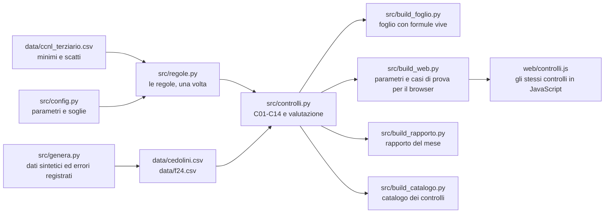

# Architettura: una regola, tre motori

Gli stessi quattordici controlli esistono tre volte, per tre modi di lavorare: uno script Python, un foglio di calcolo con
formule vive e una pagina web che gira solo nel browser. Il rischio di avere tre copie è che divergano. Questa
pagina spiega come restano uguali, e come si cambia qualcosa senza romperle.

## Il flusso

`python src/run_all.py` rifà tutto, nell'ordine. Python è il riferimento: le altre due versioni sono confrontate
con lui.

## Come restano uguali

| Verifica | Dove | Cosa garantisce |
|---|---|---|
| Foglio contro Python | foglio Riconciliazione, `src/check_workbook.py` | 563 valori del foglio uguali a quelli di Python, con le formule calcolate due volte: in Python con [excel-twin](https://github.com/D0M3N1C0X/excel-twin) nei test, con LibreOffice nella CI |
| Browser contro Python | `tests/js/check_controlli.mjs` | 2.184 valori uguali su nove casi alterati a caso, sui casi limite di ratei e cessazioni e sul CSV in formato italiano |
| Errori inseriti | `tests/test_controlli.py` | Ogni errore registrato in `data/errori_inseriti.csv` è trovato, e nessun altro cedolino è segnalato |
| Cifre del README | `tests/test_readme.py` | Ogni numero citato nel README è quello che il codice produce oggi |
| Documenti | `tests/test_docs.py` | Dizionario dei dati e catalogo completi e aggiornati |
| Riproducibilità | CI, "Text outputs are unchanged" e `src/deterministic.py` | Rifare tutto da zero dà gli stessi file di testo, e un foglio con lo stesso contenuto |
| Stile e tipi | CI, `ruff check .` | Regole in `pyproject.toml`; ogni funzione in `src/` dichiara cosa restituisce |

## Come si aggiunge un controllo

La lista viene da C12-C14, gli ultimi aggiunti. Per molti passi, se manca, un test fallisce (catalogo, dizionario dei
dati, README, confronto con il browser); per il foglio conta la riconciliazione, quindi la voce va aggiunta anche lì.

1. **La regola**, con la fonte: una funzione in `src/regole.py`, il parametro in `src/config.py`, la riga nel
   registro [fonti.md](fonti.md).
2. **Il controllo** in `src/controlli.py`: la voce in `CONTROLLI` e in `TIPO_CONTROLLO`, il valore atteso in
   `attesi()`, la segnalazione in `esegui()`.
3. **I dati**: se servono colonne nuove, in `genera.cedolino()`; poi almeno un errore inserito e registrato in coda
   a `genera.main()`, così i dati esistenti non cambiano.
4. **Il foglio** in `src/build_foglio.py`: le colonne nuove **dopo l'ultima**, per non spostare le formule che ci
   sono; esito nella colonna `Errori`; la voce nella mappa delle colonne e in `R_`; i valori attesi nella
   riconciliazione.
5. **Il browser** in `web/controlli.js`: la voce in `CONTROLLI` e lo stesso calcolo; se servono parametri, in
   `build_web.cfg()`.
6. **I testi**: `COSA_FARE` in `src/build_rapporto.py`, la scheda in `src/build_catalogo.py`, le colonne in
   [dizionario-dati.md](dizionario-dati.md), le scelte in [decisioni.md](decisioni.md).
7. **I test**: i casi limite in Python e in JavaScript; poi `python src/run_all.py`, `pytest`, il controllo
   JavaScript e `ruff check .`. Il test del README dice quali cifre aggiornare.

## Come si aggiorna il contratto

A ogni rinnovo del CCNL:

1. ricostruire `data/ccnl_terziario.csv` dalla fonte primaria (oggi la circolare Confcommercio, F01 in
   [fonti.md](fonti.md)), con la data della tranche in una colonna nuova;
2. spostare `COLONNA_MINIMO` e `COLONNA_MINIMO_PROSSIMO` in `src/config.py`;
3. rifare tutto e lasciare che i test dicano cosa è cambiato.
